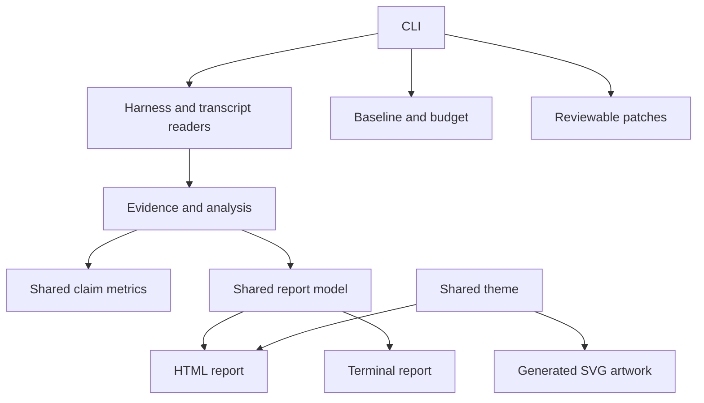

# Coherence audit — 8 November 2026

Upstream reviewed: `ebad8f30325481d4fff4487cce04255c00b2ef0a`.

The architecture has clear boundaries and a substantial regression suite. The main weaknesses
were inconsistencies between calculated values, displayed explanations, optional CLI behavior
and older marketing artwork. These are concrete correctness issues; a clean dependency graph
alone would not reveal them.

## Corrections

| Priority | Finding | Result |
|---|---|---|
| Important | Dead-share computation excluded unobservable commands, while both reports displayed the full inventory as the denominator. | Shared `deadShareClaims`; additive `deadShareTokens`; HTML and terminal show eligible tokens. A 100-token eligible claim plus a 900-token unobservable command now reads 100% of 100 eligible tokens. |
| Important | Current estimated inventory could exceed the historical median prompt. Chart percentages then exceeded 100%. | Suppress the composition chart, explain the mismatch and expose `prefixBreakdownKnown: false`. The legacy numeric remainder is not interpreted as a measured zero. |
| Important | “Payback” divided raw judge tokens by cache-weighted input tokens and described the result as financial break-even. | Remove the unsupported financial claim from both reports. Preserve disclosed token savings estimates. |
| Medium | The cache ratio used the median of all complete sessions while savings used cache-compatible sessions. | Expose and use `medianCacheTurnsPerSession` for both presentations. |
| Medium | A Codex T2 judge silently ignored the requested model and was labelled Sonnet by default. | Forward an explicit model override; otherwise use the configured Codex default and mark its identity unreported. A subprocess fixture checks the actual arguments. |
| Medium | The T2 confirmation implied that no file content or paths could leave the machine, despite sending claim text. | Align the prompt with README/SECURITY: claim text may itself contain sensitive content or paths, and the agent can load its own context. |
| Medium | HTML recommended `--t2` in Codex/static reports, where that action is unavailable. | Recommend it only for measured Claude reports. |
| Medium | Artwork showed obsolete version/measurement examples, priced unknown MCP schemas and claimed unconditional zero network. | Replace all four SVGs and the social PNG with clearly illustrative content and the T0/T1 versus optional T2 distinction. |
| Medium | Small semantic text failed contrast requirements in both report themes. | Shared dark/light tokens; automated 4.5:1 text-contrast checks against both page and panel backgrounds. |
| Medium | The npm README referenced SVG files excluded from the tarball. | Include the referenced SVGs in the package. |
| Minor | Bug-report Node requirement confused source and compiled distributions. | State Node 20+ for compiled npm and 22.18+ for source/tests. |
| Minor | Test fixtures inherited personal Git signing and failed before exercising history logic. | Disable signing only inside test Git commands. Explicitly skip Windows junction fixtures when creation is prohibited. |

## File and interface architecture

`src/cli.ts` remains the orchestration boundary. Harness discovery, transcript parsing, evidence,
analysis, baselines, patch generation and presentation remain separate. No runtime dependency
was added. Terminal output no longer imports its context type from the HTML renderer.

The graph and a separate source-level scan found **52 relative imports in 21 source modules,
no missing local targets and no import cycles**. Verified call paths cover CLI → analysis,
CLI → HTML → shared report model, CLI → patch writer → patch builder, and CLI → baseline writer.
Imports, including type-only dependencies, were checked independently of the graph's heuristic
symbol resolution.

## Graphify evidence

- Final structural graph: **603 nodes, 1,253 relations, 33 communities**.
- Detection: 68 supported files, approximately 83,628 words; 47 code files, 16 documents,
  5 images. The original PNG was not retrieved by the text connector and was replaced
  with a new raster export of the redesigned SVG.
- Semantic extraction covers 15 original documents and four original SVG sources.
  Those fragments intentionally preserve the defects found in the upstream revision;
  they do **not** claim to describe the corrected artwork or later documentation.
  This audit document has no semantic fragment and is not evidence for its own findings.
- Structural extraction reflects the corrected code. The 67 retrieved upstream text
  files were verified byte-for-byte against their Git blob hashes before modification.
- No dangling or missing graph endpoints or physical source files were found.
- Graphify collapsed 74 parallel relations with identical endpoints. The raw 1,327 edge
  records are retained in the audit bundle.
- Three self-loops comprise two bounded recursive walkers and one extractor false positive
  on `path.relative`. They are not three application defects.
- `graphify path` returned a reversed containment relation despite directed mode.
  Delivered call paths were therefore checked against the raw directed calls graph.
- No external model API was invoked for Graphify. Host-agent token usage was unavailable;
  zero numeric cost fields in its generated report are placeholders, not a measured free run.

The raw graph and HTML are generated audit artifacts, excluded by `graphify-out/`. A normal
code-only rebuild is `graphify extract . --code-only --max-workers 2`; it does not reproduce
the historical semantic fragments.

## Validation

| Check | Result |
|---|---|
| Full Node test suite | 343 tests: 341 passed, 0 failed, 2 explicit environment skips |
| TypeScript typecheck | Passed |
| Compiled build | Passed |
| Generated SVG consistency | Passed |
| Benchmark gates | 13/13 passed; no benchmark errors |
| npm tarball | Shared modules compiled; README SVG references included; source excluded |
| Installed package smoke | Claude and Codex static inventories, baseline equality, budget exit 2, invalid-option exit 1 and HTML anchors checked |
| SVG rendering | All four rendered and visually inspected; social PNG regenerated |
| Import graph | No cycles or missing local imports |
| Patch hygiene | `git diff --check` passed |

Tests run on Windows with Node 22.23.4. Two symlink/junction scenarios could not execute under
the local Windows restrictions; this is disclosed, not counted as tested behavior. The CI
matrix remains responsible for Linux/macOS/Windows and the supported Node versions.

## Boundaries and next checks

1. **Browser interaction is not certified.** Browser policy refused the local report URL.
   The existing filter/sort/reset logic is exercised by VM tests; responsive CSS, focus
   styles, anchor targets, contrast and output structure were checked. Actual rendering
   on desktop/mobile and keyboard/screen-reader behavior still need a browser review.
2. **Live provider integrations were not invoked.** Claude/Codex transcript fixtures and
   fake judge subprocesses are covered. No user transcripts or model quota were used.
   A controlled opt-in T2 smoke with each real CLI remains a release check.
3. **This is not a release.** Source and npm retain version 0.3.0; README already distinguishes
   unreleased source features. Version qualification and publication remain separate.
4. **Reduction does not prove quality.** Absence evidence, token estimates and proposed
   savings do not establish causal task-quality improvement. Preserve representative
   before/after task checks when actually applying a demotion.
5. **No “perfect symbiosis” claim.** This audit fixes reproducible inconsistencies and
   documents its coverage. It does not prove the absence of all defects.

## Maintaining the visual contract

`src/report-theme.ts` is the color source for the report and `scripts/generate-assets.ts`.
Run `npm run assets` after changing it; CI runs `npm run assets:check`. No font or asset
fetch is introduced into the HTML report. The SVG previews remain explicitly synthetic.
Refresh the PNG from `assets/social-preview.svg` when changing social artwork.
